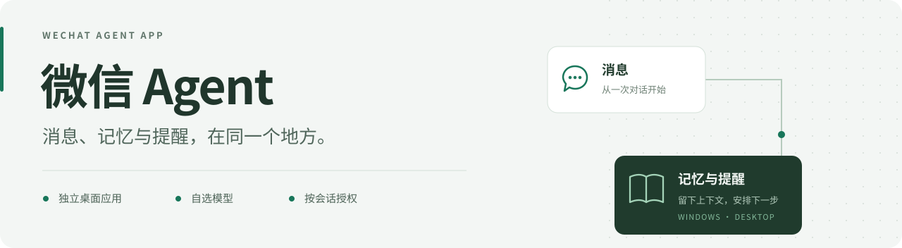
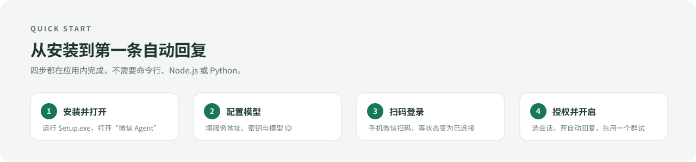
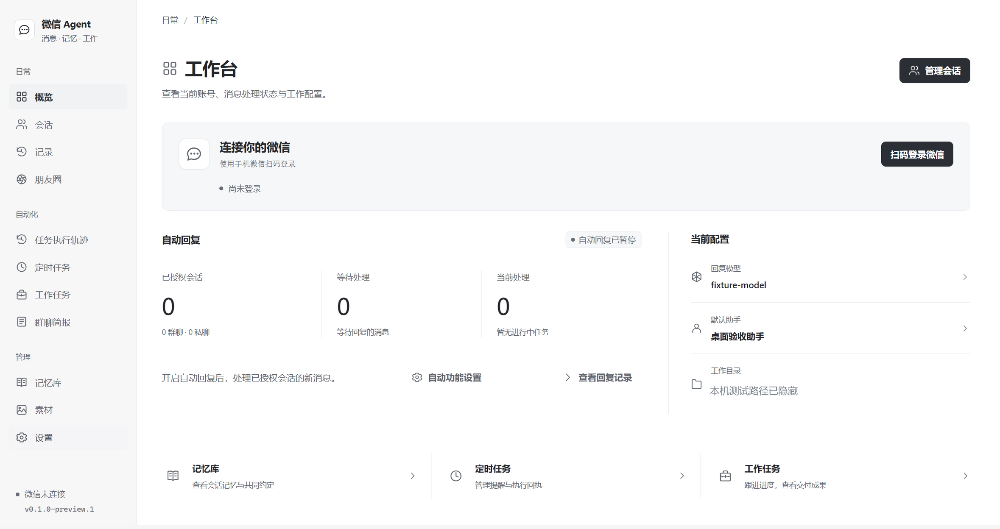
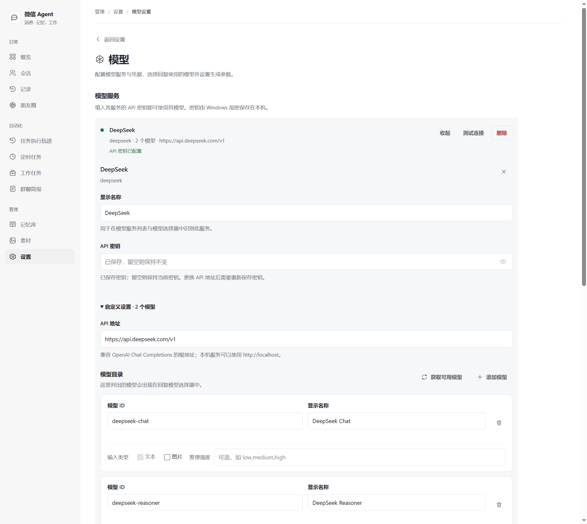
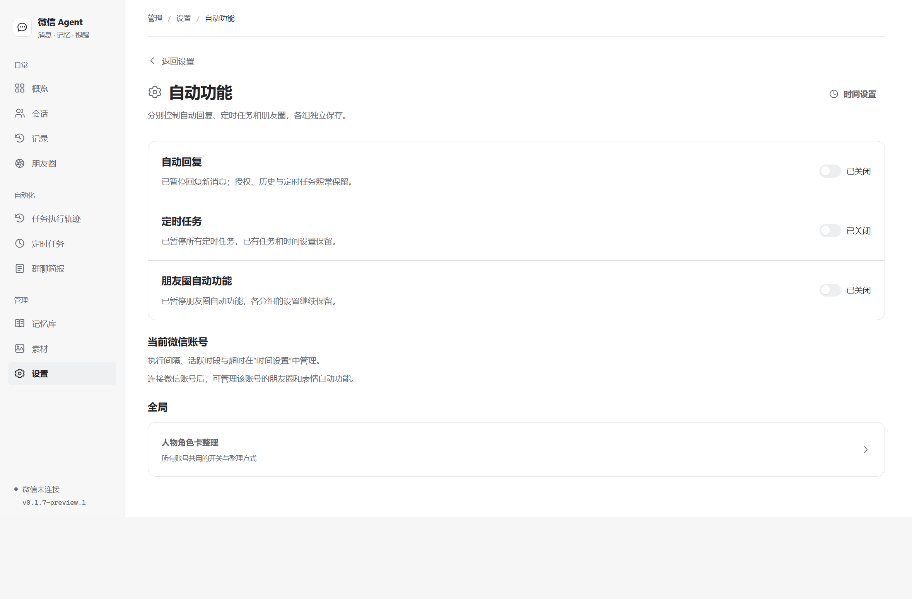
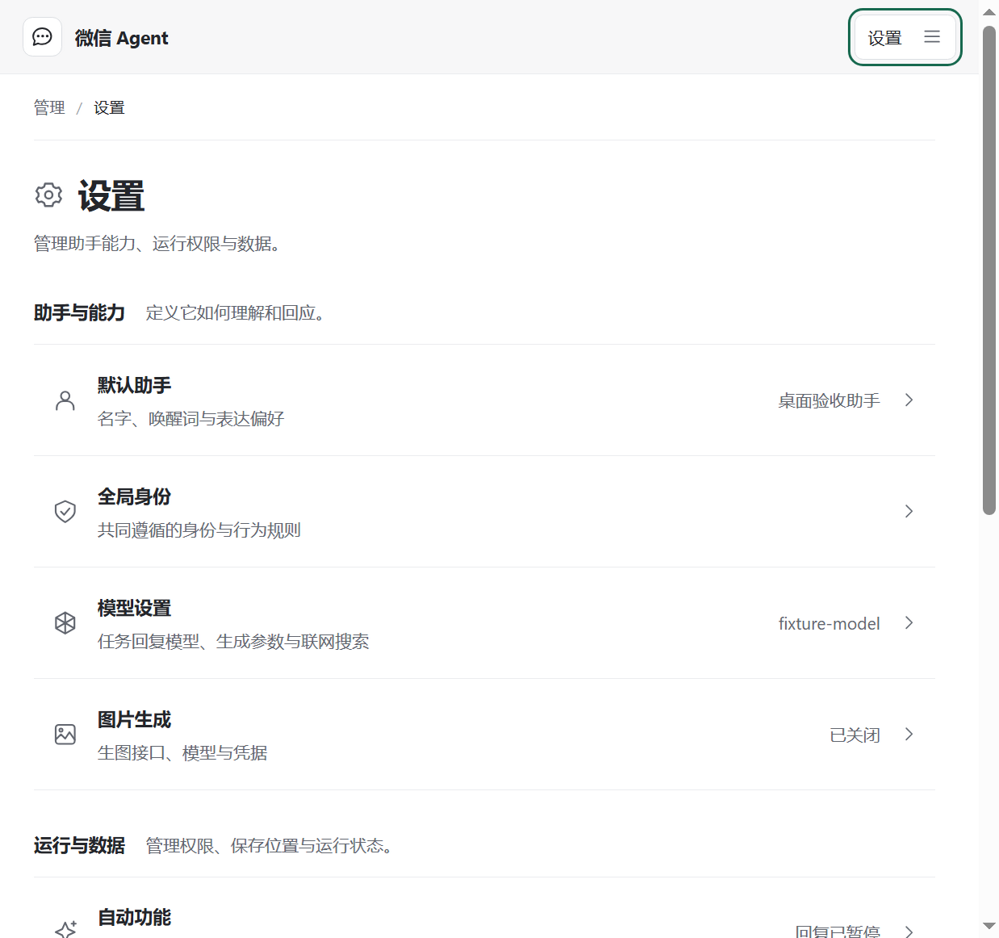
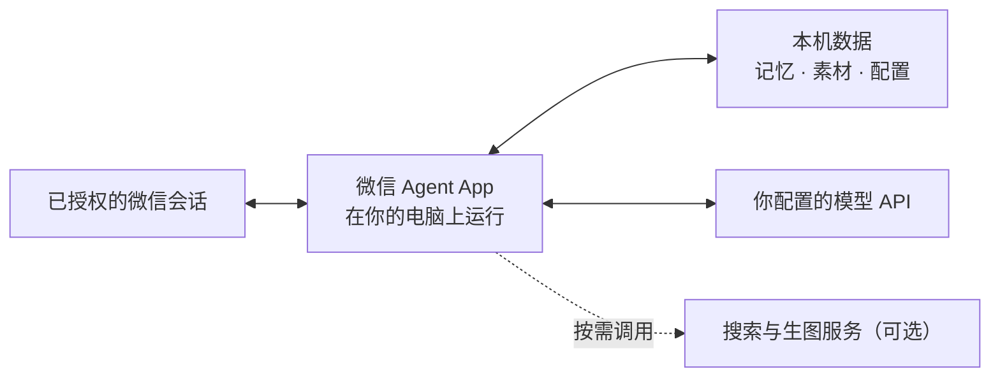
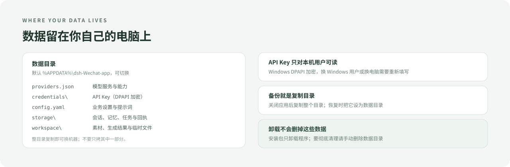

<div align="center">



<h1>微信 Agent App</h1>

<p><strong>把微信里的对话，接上你自己选的模型。</strong></p>
<p>独立运行的 Windows 微信助手：自然聊天、长期记忆、朋友圈与提醒，放在一个桌面应用里。</p>

<p>
  
  
  
  <a href="LICENSE"></a>
</p>

<h3><a href="https://github.com/Bozheng-Li/Wechat-agent-app/releases/download/v0.1.7-preview.1/Wechat-Agent-App-0.1.7-preview.1-Setup.exe">↓ 下载 Windows 安装包</a></h3>

<p>
  <a href="#新手上手教程">新手教程</a> ·
  <a href="#界面预览">界面预览</a> ·
  <a href="#运行方式与数据">数据与备份</a> ·
  <a href="#常见问题">常见问题</a> ·
  <a href="https://github.com/Bozheng-Li/Wechat-agent-app/releases/tag/v0.1.7-preview.1">版本说明</a> ·
  <a href="https://github.com/Bozheng-Li/Wechat-agent-app/issues">反馈问题</a>
</p>

</div>

> [!IMPORTANT]
> **预览版状态**：桌面界面、真实模型 API、安装、更新与卸载均已验证。独立 App 的真实微信扫码登录与在线收发仍待实机验证，详见[验证记录](docs/validation.md)。当前安装包尚未进行代码签名，Windows 可能提示“未知发布者”。

---

## 目录

| 章节 | 内容 |
| --- | --- |
| [这是什么](#这是什么) | 一句话定位、能力一览 |
| [下载安装](#下载安装) | 安装包、校验文件、版本来源 |
| [新手上手教程](#新手上手教程) | 从安装到数据备份，8 个可折叠步骤 |
| [界面预览](#界面预览) | 应用截图与各页职责 |
| [进阶配置](#进阶配置) | 推理强度、图片输入、代理、窄屏、多账号 |
| [运行方式与数据](#运行方式与数据) | 数据存放在哪、怎么备份与迁移 |
| [常见问题](#常见问题) | 连接失败、密钥、托盘、卸载 |
| [开发与贡献](#开发与贡献) | 构建、测试、验收记录 |
| [来源与许可](#来源与许可) | 上游项目与许可说明 |

## 这是什么

它不是一个网页服务，而是装在自己电脑上的 Windows 桌面程序：用你自己的模型 API 生成回复，用你自己的微信账号收发消息，数据留在本机。安装包自带桌面程序、Python 与微信运行组件，**不需要另装 Node.js、Python 或 DeepSeek Harness**。

| 能力 | 可以做什么 |
| --- | --- |
| **自然对话** | 在授权的私聊或群聊中回复；配置人设、回复风格、参与频率与活跃时间。 |
| **长期记忆** | 保存会话上下文与长期记忆，整理人物角色卡，在之后的对话里检索相关信息。 |
| **图片与素材** | 用支持图片输入的模型理解图片；管理素材、图片记忆与微信收藏表情。 |
| **聊天生图** | 配置好生图服务后，在普通会话里直接生成图片并随回复发出。 |
| **朋友圈** | 浏览与整理内容、准备发布素材，配置定时发布、点赞与回复。 |
| **提醒与任务** | 定时提醒、定时消息、群聊简报，查看执行结果与真实回执。 |
| **模型与诊断** | 多个模型 API、图片模型、推理强度，任务轨迹、连接状态与应用诊断。 |

自动功能页把自动回复、定时任务和朋友圈自动功能做成三个独立开关：暂停回复不会取消已安排的定时发送，关闭定时任务也不影响朋友圈按自己的设置运行。

搜索和生图服务按需配置：联网搜索可选 **DeepSeek 搜索**（DeepSeek 官方 Anthropic 兼容接口的服务端 web_search，只需 DeepSeek API Key）或 **Tavily 搜索**（填写 Tavily 或兼容服务地址与密钥）。两者都不配置时，助手只是不能用联网搜索，其它功能不受影响。

## 下载安装

| 文件 | 用途 | 下载 |
| --- | --- | --- |
| **Windows x64 安装包** | 直接安装和使用 | [Wechat-Agent-App-0.1.7-preview.1-Setup.exe](https://github.com/Bozheng-Li/Wechat-agent-app/releases/download/v0.1.7-preview.1/Wechat-Agent-App-0.1.7-preview.1-Setup.exe) |
| SHA-256 校验文件 | 核对下载文件完整性 | [Setup.exe.sha256](https://github.com/Bozheng-Li/Wechat-agent-app/releases/download/v0.1.7-preview.1/Wechat-Agent-App-0.1.7-preview.1-Setup.exe.sha256) |
| 本版本源码 | 阅读代码、修改或自行构建 | [Source code](https://github.com/Bozheng-Li/Wechat-agent-app/archive/refs/tags/v0.1.7-preview.1.zip) |

安装包约 250 MB，包含运行所需的全部组件。安装向导可以选择安装位置；卸载会保留数据目录。

<details>
<summary><strong>怎么核对安装包没有被改过</strong></summary>

同时下载 `.exe` 和 `.sha256`，在 PowerShell 里执行：

```powershell
Get-FileHash -Algorithm SHA256 .\Wechat-Agent-App-0.1.7-preview.1-Setup.exe
```

把输出的值与 `.sha256` 文件里的值逐位比对，一致就说明文件完整。SHA-256 只能核对“下载是否完整”，不能替代代码签名——预览版没有代码签名，因此 Windows 首次运行可能弹出“未知发布者”提示。

</details>

<details>
<summary><strong>这个版本会怎么更新</strong></summary>

应用启动后会静默检查新版本，发现更新时在页面顶部提示；也可以打开 **设置 → 版本与更新** 手动检查、下载并安装。

更新包从本项目的发布页下载，安装前会核对发布文件里的 SHA-512，覆盖安装后聊天记录、会话授权与模型配置都会保留。预览版不会被 GitHub 的「最新版」入口收录，所以当稳定入口缺少 `latest.yml` 时，应用会改为在发布列表里查找最新的发布文件。

</details>

## 新手上手教程



下面每一步都可以单独展开。第一次使用建议按顺序做完 1–4，跑通一条自动回复之后，再决定要不要开记忆、生图与朋友圈。

<details open>
<summary><strong>第 1 步 · 安装并第一次打开</strong></summary>

1. 双击 `Wechat-Agent-App-0.1.7-preview.1-Setup.exe`，按向导选择安装位置。
2. 安装完成后从开始菜单打开 **微信 Agent**。
3. 第一次启动不会读取旧插件的账号，也不会自动连接旧账号，界面停在 **概览**，显示“微信未连接”。

几个值得先知道的约定：

- **一个 Windows 用户只运行一个主应用**。重复打开只会恢复已有窗口；即使指定了不同的数据目录，也不会创建第二个实例。
- **关闭窗口不是退出**。关闭后应用缩到系统托盘继续做事；要完全停止，右键托盘选择 **退出并停止微信助手**。
- 应用需要保持运行：电脑休眠、关机或应用退出期间，提醒和后台任务不会执行。

</details>

<details>
<summary><strong>第 2 步 · 配置模型 API（最关键的一步）</strong></summary>

进入 **设置 → 模型设置 → 模型 API 服务**，添加一个兼容 Chat Completions 的服务。

| 设置项 | 怎么填 |
| --- | --- |
| 服务编号 | 本机识别用的短名，例如 `my-provider`，避免空格。 |
| 显示名称 | 方便辨认，例如“我的模型服务”。 |
| API 根地址 | 服务商给的根地址，通常带 `/v1`；本机服务支持 `http://localhost` 与回环地址。 |
| API Key | 自己的密钥；本机免密服务可以勾选“服务无需 API Key”。 |
| 模型 ID | 服务商提供的**准确**名称，每行一个。 |
| 图片输入 | 只有模型真的支持读图时才打开，否则看图会失败。 |
| 推理强度 | 按模型实际能力填写，不确定就留空。 |

填完点击 **保存服务**，再点 **测试已保存的连接**——测试用的是这个服务已保存列表里的第一个模型。测试通过后，在下方 **模型连接** 里选择真正用于回复的模型。

> [!TIP]
> 模型 ID 写错是最常见的失败原因：它必须和服务商文档里完全一致，大小写和连字符都算。连接测试失败时，先核对根地址、模型 ID、密钥和系统代理，再怀疑服务本身。

看图需要一个支持图片输入的模型；生图需要单独的服务配置（见第 6 步）。在线调用会产生服务商费用，安装包不提供内置密钥。

</details>

<details>
<summary><strong>第 3 步 · 扫码登录微信</strong></summary>

在 **概览** 页点击 **扫码登录微信**，用手机微信扫码，按页面提示确认。登录状态会显示在左侧栏底部，从“微信未连接”变为已连接。

登录成功后先做两件小事：

- 打开 **会话** 页，确认列表里能看到你的聊天。
- 打开 **记录** 页，确认收到的消息开始进入记录。

> [!NOTE]
> 独立 App 的真实微信扫码登录与在线收发仍待实机验证。如果你在登录环节遇到问题，请附上应用版本、Windows 版本和页面上的错误提示提交 [Issue](https://github.com/Bozheng-Li/Wechat-agent-app/issues)。

</details>

<details>
<summary><strong>第 4 步 · 授权会话，开启第一条自动回复</strong></summary>

进入 **会话** 页，选择允许助手参与的私聊或群聊。**没授权的会话，助手不会回复**——这是刻意的默认值。

建议这样开始：

1. 只授权**一个**自己熟悉的群或小号私聊。
2. 回到 **概览**，在 **自动功能设置** 里打开自动回复。
3. 在授权的会话里发一句话，看它是否回复，以及回复的风格是否合适。
4. 满意之后，再逐个放开更多会话。

概览页会实时显示已授权会话数、等待处理与当前处理的消息数，以及当前使用的回复模型和默认助手。

</details>

<details>
<summary><strong>第 5 步 · 人设、长期记忆与脱敏</strong></summary>

**人设**在 **设置** 里的默认助手中修改：名字、背景、性格、说话风格。应用只保留一个全局默认助手，所有会话共用，不需要给每个群单独写人设。

**长期记忆**在应用里自动整理：把聊天中明确表达的身份、偏好、禁忌、约定与更正保存成有来源的事实，之后对话时按需检索。记忆库页可以查看、编辑与删除这些条目。

> [!IMPORTANT]
> 记忆默认**脱敏**：写事实和备注时用「用户本人」「同学A」「同事B」这类代称，不记录真实姓名、微信号、手机号、住址和单位；引用原话时保留原文。这样导出的记忆、截图或分享给别人时，不会顺带泄露真实身份。

不确定要不要开记忆时，建议先只开自动回复跑一天：记忆会消耗额外的模型调用，也会让你看到更长的上下文成本。

</details>

<details>
<summary><strong>第 6 步 · 在聊天里生图</strong></summary>

生图是**可选**能力，需要在 **设置 → 生图** 里配置一个兼容 OpenAI `images/generations` 的服务：接口名称、地址、模型（例如 `gpt-image-2`）和 API Key。

保存之后，只要这个接口显示为已配置，普通聊天里就可以直接说：

> “画一张在窗台上晒太阳的橘猫，水彩风。”

助手会调用生图接口生成真实图片，存进素材库，并随这条回复一起发出去。没有配置生图服务时，这个工具不会出现在对话里，助手也会如实说明这次没有生成。

> [!TIP]
> 生图比文字慢得多（一张常要几十秒）。如果对方性子急，可以让人设在生图前先说一句“我在画，等一下”，回复会先把这句话发出去。

</details>

<details>
<summary><strong>第 7 步 · 搜索、朋友圈与定时任务</strong></summary>

- **联网搜索**：在 **设置** 里填 DeepSeek 搜索或 Tavily 搜索的地址与密钥。配好之后，助手在需要新信息时会自己搜索，并在回复里带上来源。
- **朋友圈**：**朋友圈** 页浏览与整理内容、准备发布素材；自动点赞与回复在自动功能设置里单独开关。生图也可以用于朋友圈素材。
- **定时任务**：用自然语言说“明天下午三点提醒我确认会议材料”，助手会创建提醒；**定时任务** 页可以看到计划、执行结果与真实回执。没有收到回执时，应用不会假装已经发送。
- **群聊简报**：在 **群聊简报** 页对指定群生成一段时间内的摘要。

自动回复、定时任务、朋友圈自动功能是三个独立开关：暂停回复不会取消已安排的定时发送，关闭定时任务也不影响朋友圈按自己的设置运行。

</details>

<details>
<summary><strong>第 8 步 · 数据目录、备份与换电脑</strong></summary>

默认数据目录是 `%APPDATA%\dsh-Wechat-app`，可以用环境变量 `WECHAT_APP_HOME` 指定启动目录。

**设置 → 存储 → 数据目录** 还能把桌面版指向 DSH 插件正在用的那个微信 Agent 数据目录（插件把位置记录在 `~/.dsh/wechat-agent/location.json`），两端于是共用同一份账号、配置、记录与记忆：

| 操作 | 结果 |
| --- | --- |
| **直接使用这个目录** | 下次启动改用目标目录；目标里已有的账号与记录继续可用。两端登录同一个微信账号时，这就是共用同一份数据的方式。 |
| **复制当前数据过去** | 先把当前目录复制到目标（跳过缓存与实例锁），再切换过去。 |
| 同一个目录两端同时开 | 后来的那一端会提示“正被另一个实例使用”，不会写坏数据。 |

切换或复制只在重启后生效；失败时继续使用原来的目录并显示原因。换电脑时关闭应用、复制整个数据目录，在新机器上选择这个目录即可继续使用。

</details>

## 界面预览



<details>
<summary><strong>展开：模型设置页</strong></summary>



</details>

<details>
<summary><strong>展开：自动功能页</strong></summary>



</details>

<details>
<summary><strong>展开：窄窗口下的布局</strong></summary>



</details>

截图来自未登录的隔离测试环境，使用示例配置；界面中的本机路径已隐藏。

## 进阶配置

<details>
<summary><strong>多个模型与用途分工</strong></summary>

可以保存多个 API 服务，并给不同用途选不同模型：

- **回复模型**：日常对话与工具调用，速度和成本最敏感。
- **看图模型**：必须支持图片输入；只有它负责理解图片内容。
- **生图服务**：独立的 `images/generations` 接口。
- **搜索服务**：DeepSeek 搜索或 Tavily 搜索，二选一即可。

每个服务各自保存密钥，互不共用；改名或改地址后需要重新保存密钥。

</details>

<details>
<summary><strong>推理强度与图片输入</strong></summary>

推理强度（reasoning effort）按服务商支持的取值填写，例如 `low` / `medium` / `high`，每行一个；模型不支持时留空，应用不会强行发送这个参数。图片输入只是一个能力开关：关掉后，模型不会被要求读图，也不会因为图片内容答错。

</details>

<details>
<summary><strong>代理与网络</strong></summary>

桌面联网请求跟随 Windows 系统代理。如果模型服务需要走代理才能连通，先在系统设置里配好代理，再回到应用里点 **测试已保存的连接**。本机或内网服务（`http://localhost`、回环地址）不需要代理。

</details>

<details>
<summary><strong>活跃时间、参与频率与回复风格</strong></summary>

在自动功能设置里可以限制助手什么时候参与：

- **活跃时间**：只在设定时段内回复，其余时间保持安静。
- **参与频率**：群聊里按概率回复，避免每句都接。
- **回复风格**：控制长度与语气；设置页里能看到当前生效的全局语言与言辞边界。

</details>

<details>
<summary><strong>环境变量（进阶）</strong></summary>

| 变量 | 作用 |
| --- | --- |
| `WECHAT_APP_HOME` | 启动时使用的数据目录，覆盖默认值。 |
| `DSH_HOME` | DSH 主目录，默认 `~/.dsh`；用于定位插件的数据目录指针。 |

一般用户不需要设置这些变量；使用安装包并从开始菜单启动即可。

</details>

## 运行方式与数据

关闭窗口后，应用继续在系统托盘运行。需要完全停止时，右键托盘选择 **退出并停止微信助手**。电脑休眠、关机或应用退出期间，提醒和后台任务无法执行。





| 内容 | 存储方式 |
| --- | --- |
| 模型服务与能力配置 | `providers.json`，不包含明文 API Key。 |
| API Key | `credentials/`，使用 Windows DPAPI 加密，与当前操作系统用户绑定。 |
| 业务设置与提示词 | `config.yaml`、`prompts/`。 |
| 会话、记忆、素材与任务 | `storage/`、`workspace/`。 |

调用在线模型、搜索或生图服务时，应用会发送完成相应任务所需的输入，费用由配置的服务商收取。数据不经过项目作者的服务器。

卸载会保留数据目录。迁移到其他 Windows 用户或电脑时，需要重新填写 API Key。

## 常见问题

<details>
<summary><strong>为什么有多个进程，但只有一个窗口？</strong></summary>

桌面窗口、渲染进程和微信运行服务会使用子进程。同一 Windows 用户的主应用受单实例锁保护，重复启动只会恢复原窗口。

</details>

<details>
<summary><strong>连接测试失败，先检查什么？</strong></summary>

按这个顺序排查：模型 ID 是否与服务商文档完全一致 → API 根地址是否带对 `/v1` → 密钥是否保存成功 → 系统代理是否能连通该服务。服务需要兼容 Chat Completions；图片输入与推理强度应与模型实际支持的参数一致。

</details>

<details>
<summary><strong>提示“请先在模型设置中保存此服务的 API Key”</strong></summary>

先确认 **设置 → 模型设置** 里该服务显示为已保存，再重新保存一次密钥即可刷新状态。这类提示只反映“当时没有读到密钥”，保存成功后不会再出现。换 Windows 用户或换电脑后，DPAPI 解不开旧密钥，需要重新填写。

</details>

<details>
<summary><strong>关闭窗口以后，为什么任务还在继续？</strong></summary>

关闭窗口会隐藏到托盘，后台服务继续运行。使用托盘的“退出并停止微信助手”才会真正停止应用及其后台服务；完全退出后，提醒不会补发。

</details>

<details>
<summary><strong>提示数据目录正被另一个实例使用</strong></summary>

同一个数据目录同一时间只允许一个端写入。常见情况是 DSH 插件与桌面版指向了同一个目录：退出其中一个，或把桌面版切换到另一个目录，然后重启应用。

</details>

<details>
<summary><strong>卸载会删除我的聊天记录和记忆吗？</strong></summary>

不会。卸载只移除程序，数据目录保留。需要彻底清理时，手动删除数据目录（`%APPDATA%\dsh-Wechat-app` 或你自定义的目录）。

</details>

## 开发与贡献

这是可以独立构建的源码仓库：`desktop/` 是 Electron 外壳，`backend/` 与 `modules/` 是应用与微信通道，`frontend/` 是界面，`tests/` 是验收测试。

- 运行与构建流程见[开发指南](docs/development.md)。
- 已完成的验收及其范围见[验证记录](docs/validation.md)。
- 版本变化见[更新日志](CHANGELOG.md)。

欢迎通过 [Issues](https://github.com/Bozheng-Li/Wechat-agent-app/issues) 提交可复现的问题，请附上应用版本、Windows 版本、操作步骤和经过隐私处理的错误信息。

## 来源与许可

本项目从 [dsh-Wechat-Agent](https://github.com/Bozheng-Li/dsh-Wechat-Agent) 拆出独立桌面应用，微信连接部分源自 [Wechat Agent](https://github.com/2720480371/wechat-agent)。

项目源码采用 **AGPL-3.0-or-later**，见 [LICENSE](LICENSE)。依赖及专有组件分别遵循其原有许可；安装包中的腾讯微信组件不由 AGPL 授权，详见 [THIRD_PARTY_NOTICES.md](THIRD_PARTY_NOTICES.md)。本项目与腾讯或 DeepSeek 无关联，其名称仅用于说明兼容目标。
