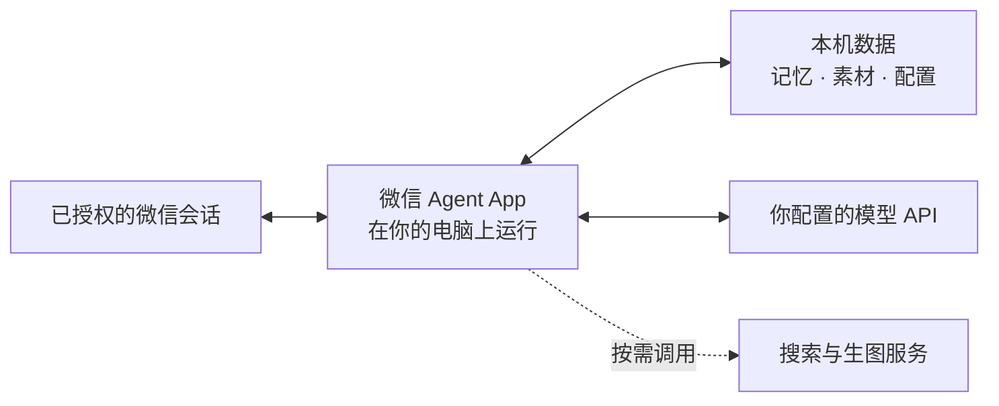

<div align="center">


<h1>微信 Agent App</h1>

<p><strong>让微信里的对话，接上你的 AI 工作流。</strong></p>
<p>独立运行的 Windows 微信助手，把自然聊天、长期记忆、朋友圈与定时任务放进一个桌面应用。</p>

<p>
  
  
  <a href="LICENSE"></a>
</p>

<h3><a href="https://github.com/Bozheng-Li/Wechat-agent-app/releases/download/v0.1.6-preview.1/Wechat-Agent-App-0.1.6-preview.1-Setup.exe">↓ 下载 Windows 安装包</a></h3>

<p>
  <a href="https://github.com/Bozheng-Li/Wechat-agent-app/releases/tag/v0.1.6-preview.1">版本说明</a> ·
  <a href="#开始使用">开始使用</a> ·
  <a href="docs/validation.md">验证记录</a> ·
  <a href="https://github.com/Bozheng-Li/Wechat-agent-app/issues">反馈问题</a>
</p>

</div>

---

## 下载安装

下载 `.exe` 安装包，安装后打开“微信 Agent”。安装包包含桌面程序、Python 与微信运行组件，使用者无需另行安装 Node.js、Python 或 DeepSeek Harness。

| 文件 | 用途 | 下载 |
| --- | --- | --- |
| **Windows x64 安装包** | 直接安装和使用 | [Wechat-Agent-App-0.1.6-preview.1-Setup.exe](https://github.com/Bozheng-Li/Wechat-agent-app/releases/download/v0.1.6-preview.1/Wechat-Agent-App-0.1.6-preview.1-Setup.exe) |
| SHA-256 校验文件 | 核对下载文件的完整性 | [Setup.exe.sha256](https://github.com/Bozheng-Li/Wechat-agent-app/releases/download/v0.1.6-preview.1/Wechat-Agent-App-0.1.6-preview.1-Setup.exe.sha256) |
| 本版本源码 | 阅读代码、修改或自行构建 | [Source code](https://github.com/Bozheng-Li/Wechat-agent-app/archive/refs/tags/v0.1.6-preview.1.zip) |

> **预览版状态**：桌面界面、真实模型 API、安装、更新与卸载已验证。独立 App 的真实微信扫码登录和在线收发仍待实机验证，详见[验证记录](docs/validation.md)。当前安装包尚未进行代码签名。

> **检查更新**：应用启动后会静默检查新版本，发现更新时在页面顶部提示；也可以打开 **设置 → 版本与更新** 手动检查、下载并安装。更新包从本项目的发布页下载，安装前会核对发布文件里的 SHA-512，覆盖安装后聊天记录、会话授权与模型配置都会保留。预览版不会被 GitHub 的「最新版」入口收录，因此当稳定入口缺少 `latest.yml` 时，应用会改为在发布列表里查找最新的发布文件。

## 消息、记忆与工作，在同一个地方

模型由你选择，会话由你授权，数据保存在自己的电脑上。可以从简单的自动回复开始，再按需启用记忆、素材与任务。

| 能力 | 可以做什么 |
| --- | --- |
| **自然对话** | 在授权的私聊或群聊中回复，配置助手人设、回复风格、参与频率与活跃时间。 |
| **长期记忆** | 保存会话上下文与长期记忆，整理人物角色卡，在之后的对话中检索相关信息。 |
| **图片与素材** | 使用支持图片输入的模型理解图片，管理素材、图片记忆与自己的微信收藏表情；配置好生图服务后，聊天里也能直接生成图片发出去。 |
| **朋友圈** | 浏览与整理内容、准备发布素材，配置定时发布、点赞和回复。 |
| **提醒与任务** | 创建定时提醒与定时消息、生成群聊简报，在朋友圈和素材中安排生图，查看执行结果与回执。 |
| **模型与诊断** | 配置多个模型 API、图片模型和推理强度，查看任务轨迹、连接状态与应用诊断。 |

搜索和生图服务按需配置。联网搜索可选 **DeepSeek 搜索**（DeepSeek 官方 Anthropic 兼容接口的服务端 web_search，只需 DeepSeek API Key）或 **Tavily 搜索**（填写 Tavily 或兼容服务地址与密钥）。助手回复时可使用应用提供的记忆、搜索、生图与朋友圈工具。

自动功能页把自动回复、定时任务和朋友圈自动功能做成三个独立开关：暂停回复不会取消已安排的定时发送，关闭定时任务也不影响朋友圈按自己的设置运行。

### 界面预览


<details>
<summary><strong>展开查看模型设置</strong></summary>


</details>

截图来自未登录的隔离测试环境，使用示例配置；工作台中的本机路径已隐藏。

## 开始使用

### 1. 安装并打开应用

下载上方安装包，按向导选择安装位置，然后打开“微信 Agent”。初次启动不会读取旧插件账号或自动连接旧账号。

同一 Windows 用户只会运行一个 App。重复打开会恢复已有窗口，使用不同数据目录也不会创建第二个实例。

### 2. 配置你的模型

进入 **设置 → 模型设置 → 模型 API 服务**，添加一个兼容 Chat Completions 的服务。

| 设置 | 填写方式 |
| --- | --- |
| 服务编号 | 例如 `my-provider`，用于在本机识别这个服务。 |
| 显示名称 | 方便辨认的名称，例如“我的模型服务”。 |
| API 根地址 | 服务商提供的根地址，通常带 `/v1`；本机服务支持 `http://localhost` 和回环地址。 |
| API Key | 自己的服务密钥；本机免密服务可勾选“服务无需 API Key”。 |
| 模型 ID | 服务商提供的准确名称，每行一个。 |
| 图片输入、推理强度 | 按模型实际能力设置；没有对应能力时保留默认值。 |

点击 **保存服务**，再点击 **测试已保存的连接**。连接测试使用这个服务已保存列表中的第一个模型。测试成功后，在下方“模型连接”中选择实际用于回复的模型。

看图需要选择支持图片输入的模型；搜索和生图需要填写各自的服务配置。在线 API 调用可能产生服务商费用，安装包不提供内置密钥。

### 3. 连接微信

在 **概览** 中点击 **扫码登录微信**，使用手机微信扫码，按页面状态完成连接。

### 4. 选择授权会话与自动功能

进入 **会话** 页，选择允许助手参与的私聊或群聊，再按需开启自动回复、记忆、提醒和朋友圈功能。可以先选择一个会话，确认模型和回复风格后再扩展使用范围。

后续可以用自然语言提出请求，例如：

> “明天下午三点提醒我确认会议材料。”
>
> “查一下我们之前讨论过的咖啡偏好。”
>
> “帮我整理一份今天的群聊简报。”

具体执行取决于已配置的模型能力、会话授权和启用的功能。

## 运行方式与数据

关闭窗口后，应用继续在系统托盘运行。需要完全停止时，右键托盘选择 **退出并停止微信助手**。电脑休眠、关机或应用退出期间，提醒和后台任务无法执行。



调用在线模型、搜索或生图服务时，应用会发送完成相应任务所需的输入，费用由配置的服务商收取。桌面联网请求跟随 Windows 系统代理。

默认数据目录为 `%APPDATA%\dsh-Wechat-app`，可用 `WECHAT_APP_HOME` 指定启动数据目录。**设置 → 存储 → 数据目录** 还可以把桌面版指向 DSH 插件正在用的那个微信 Agent 数据目录（插件把位置记录在 `~/.dsh/wechat-agent/location.json`），两端于是共用同一份账号、配置、记录与记忆：

- **直接使用这个目录**：下次启动改用目标目录，目标里已有的账号与记录继续可用。两端登录的是同一个微信账号时，这就是让两端共用同一份数据的方式；目标属于另一个账号时会再要求确认一次。
- **复制当前数据过去**：先把当前目录里的数据复制到目标（跳过缓存与实例锁），再切换过去。
- 同一个数据目录同一时间只能有一个端在运行，另一端会提示“正被另一个实例使用”；切换或复制只在重启后生效，失败时继续使用原来的目录并显示原因。
- 换电脑时关闭应用、复制整个数据目录，在新机器上选择这个目录即可继续使用。

| 内容 | 存储方式 |
| --- | --- |
| 模型服务与能力配置 | `providers.json`，不包含明文 API Key。 |
| API Key | `credentials/`，使用 Windows DPAPI 加密，与当前操作系统用户绑定。 |
| 业务设置与提示词 | `config.yaml`、`prompts/`。 |
| 会话、记忆、素材与任务 | `storage/`、`workspace/`。 |

卸载会保留数据目录。迁移到其他 Windows 用户或电脑时，需要重新填写 API Key。

## 常见问题

<details>
<summary><strong>为什么有多个进程，但只有一个窗口？</strong></summary>

桌面窗口、渲染和微信运行服务会使用子进程。同一 Windows 用户的主应用受单实例锁保护，重复启动只恢复原窗口。

</details>

<details>
<summary><strong>连接测试失败，先检查什么？</strong></summary>

确认已经保存服务，再核对 API 根地址、准确模型 ID、密钥与网络代理。服务需要兼容 Chat Completions；图片输入和推理强度应与模型实际支持的参数一致。

</details>

<details>
<summary><strong>关闭窗口以后，为什么任务还在继续？</strong></summary>

关闭窗口会隐藏到托盘。使用托盘的“退出并停止微信助手”才会停止应用及其后台服务。

</details>

<details>
<summary><strong>如何核对安装包？</strong></summary>

同时下载 `.exe` 和 `.sha256`，在 PowerShell 中执行以下命令，并与校验文件中的值比较：

```powershell
Get-FileHash -Algorithm SHA256 .\Wechat-Agent-App-0.1.6-preview.1-Setup.exe
```

SHA-256 用于核对发布文件的完整性，不能替代代码签名。

</details>

## 开发与贡献

这是可以独立构建的源码仓库。运行和构建流程见[开发指南](docs/development.md)，已完成的验收及其范围见[验证记录](docs/validation.md)，版本变化见[更新日志](CHANGELOG.md)。

欢迎通过 [Issues](https://github.com/Bozheng-Li/Wechat-agent-app/issues) 提交可复现的问题。请附上应用版本、Windows 版本、操作步骤和经过隐私处理的错误信息。

## 来源与许可

本项目从 [dsh-Wechat-Agent](https://github.com/Bozheng-Li/dsh-Wechat-Agent) 拆出独立桌面应用，微信连接部分源自 [Wechat Agent](https://github.com/2720480371/wechat-agent)。

项目源码采用 **AGPL-3.0-or-later**，见 [LICENSE](LICENSE)。依赖及专有组件分别遵循其原有许可；安装包中的腾讯微信组件不由 AGPL 授权，详见 [THIRD_PARTY_NOTICES.md](THIRD_PARTY_NOTICES.md)。本项目与腾讯或 DeepSeek 无关联，其名称仅用于说明兼容目标。
